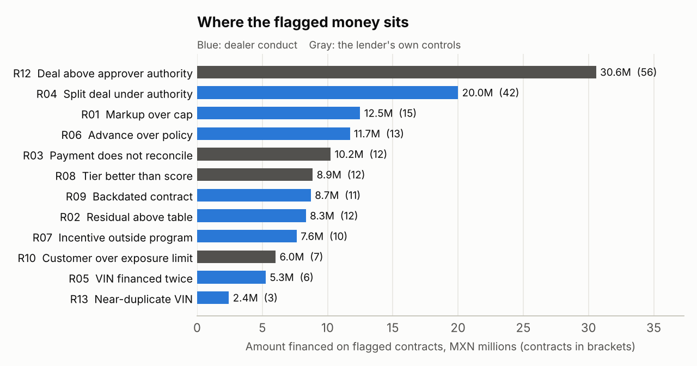

# FleetAudit

**A case study and working prototype for auditing a fleet credit book after the contracts are booked.** It checks the data, runs 14 anomaly rules in SQL, scores and ranks what they find in Python, and writes a one-page report that says what to do next. The book it runs on is invented.

> **A simulation based on my experience as a Dealer Sales Analyst at GMF.** The audit work I did there was on applicants, not on booked contracts: I reviewed each applicant's document package against the lender's checklist, and approved contracts were then booked by hand, one at a time. This project asks what a second look at the booked contracts could add, and answers it on a book that is **entirely invented**. The process is described in general terms. No GMF data, documents, systems, policies, thresholds or figures are used: every dealer, customer, vehicle model, rate sheet, incentive program, approval limit and contract is generated by `fleetaudit/generate.py`. The project is not affiliated with or endorsed by GMF or any manufacturer. The anomaly patterns are ones that are widely known across auto finance.



## Start here

| If you want | Read |
|---|---|
| The analysis case and the proposal | [`docs/case.md`](docs/case.md) |
| The one-page result on the default book | [`reports/findings.md`](reports/findings.md) |
| How well detection works, scored on 20 books | [`reports/evaluation.md`](reports/evaluation.md) |
| The reasoning behind each rule | [`docs/methodology.md`](docs/methodology.md) |

## Context

Fleet customers come in three kinds: individuals, individuals with business activity (PFAE) and companies. Each kind sends a different set of documents, and a reviewer checks the package against the checklist for its kind. The answer is a yes or no. Larger requests go to a commercial credit team that sets the limit from the income the applicant states. Approved contracts are booked by hand, one at a time. The loan is not paid to the customer: the money goes to a dealer, often one outside the manufacturer's own network, and the lender buys the vehicles from it directly.

Every step in that chain is careful, and every step looks at one file. This project asks what a second look at the whole booked book would add: the same vehicle on two contracts, a customer funded past their limit across several contracts, a dealer whose paper keeps showing the same problem, a payment that was keyed wrong. The case ends with a proposal for a four-week, read-only pilot.

Not covered yet: the front half of the chain, meaning the applicant's package and the approved-versus-booked check. It is planned as the next module (section 8 of the case).

## The book

A synthetic portfolio of commercial fleet contracts in Mexico (MXN), Jul 2023 to Mar 2026, as of 30 Jun 2026:

- **2,262 contracts in 710 deals** from 41 dealers to 186 fleet customers (all companies), MXN 1.8B originated
- 1,466 loans and 796 leases across 9 invented models (sedans to electric vans), 24 to 72 months
- A monthly **rate sheet** by credit tier and term that moves in quarter-point steps
- **Manufacturer incentive programs** with windows, eligible models and subvention paid to the lender
- **Residual tables**, mileage adjustments, LTV caps by tier, add-on and price caps
- Four levels of **approval authority** and customer **exposure limits** with history
- **41,682 payment records**, with delinquencies, early defaults, payoffs and charge-offs

The generator builds a clean book that follows policy, then plants known problems and legal
look-alikes next to every rule, and writes the answer key to `data/ground_truth.json`.
Detection code never reads that file; only the evaluation does.

## What it finds

| Rule | Finding | Owner | How |
|---|---|---|---|
| R01 | Dealer markup above the cap (none allowed on subvented programs) | Dealer | rate stack vs policy |
| R02 | Lease residual above the residual table | Dealer | mileage-adjusted table lookup |
| R03 | Payment that does not reconcile with amount, rate, term, residual | Lender | amortization recomputed in SQL |
| R04 | Deal split into near-limit pieces to stay under approval authority | Dealer | self-join of deals in a 7-day window |
| R05 | VIN financed again while the first contract is open | Dealer | self-join with open-period overlap |
| R06 | Power booking: LTV, add-ons or price above policy | Dealer | three caps, counted |
| R07 | Program rate outside its window, model or term | Dealer | program eligibility join |
| R08 | Credit tier better than the score earns, no valid override | Lender | `ASOF JOIN` on score bands |
| R09 | Backdated contract that captured a closed program or older rate sheet | Dealer | entry lag plus proof of benefit |
| R10 | Customer funded past the exposure limit in force that day | Lender | scheduled balances at every funding date, `ASOF JOIN` on limit history |
| R11 | Dealer whose early-payment defaults are too frequent to be chance | Dealer | 95% Wilson lower bound vs portfolio rate |
| R12 | Deal signed above the approver's authority | Lender | deal totals vs authority |
| R13 | VIN one character away from an open contract (cloned or mis-keyed) | Dealer | Hamming distance on same model and year |
| R14 | Near-limit deals spread over a month (weak, review only) | Dealer | R04 over a 30-day window |

Each rule is a SQL view in [`sql/03_rules.sql`](sql/03_rules.sql) that returns the same five
columns, so they union into one table of hits. Every threshold is read from a `policy` table
loaded from [`fleetaudit/config.py`](fleetaudit/config.py); the SQL contains no magic numbers.

On top of the rules:

- **Scoring** (`fleetaudit/score.py`): points per rule, tiers (high 50+, medium 25+, low), and a
  split between **dealer conduct** and the lender's **own controls**, because the fix is different.
- **Statistical layer**: an isolation forest on ten robust-scaled contract features. It never
  makes a finding on its own; it adds a few points to the most unusual 1%.
- **Dealer scorecard**: share of volume with conduct findings, breadth of findings, early defaults.
- **Approver scorecard**: control findings per credit approver.
- **Data-quality gate** (`sql/02_quality.sql`): 13 checks (identities, rate-sheet lookups, schedule
  gaps, payments after close...). If any fails, the audit refuses to report.

The result for the default book is in [`reports/findings.md`](reports/findings.md). Of its 199
contracts at medium or high, 87 trace to the lender's own controls and 112 to dealer conduct; the
case explains why that split matters.

## How well it works

[`reports/evaluation.md`](reports/evaluation.md) scores detection against the answer key on 20
different books (3,798 planted contracts and 1,865 look-alikes):

- Every first-line pattern is caught by its rule and reaches medium or high. **No contract that
  was not planted reaches medium or high, and no look-alike does.**
- All 40 early-default dealers are flagged with no false flags; a tiny dealer with one early
  default (25% raw rate) never is.
- Three **evasive variants** are planted to find the limits:
  - splits spread 9 to 13 days apart slip past R04. R14 catches all of them but also every
    genuine repeat order (31% of its hits are real), so it only queues for review;
  - a VIN with one character changed slips past R05; R13 catches all of them with no false hits;
  - backdating with the keying lag kept under 15 days is **caught by nothing**. That is a process
    gap (time-stamped capture at the dealer), not something a lower threshold should paper over.
- The isolation forest alone finds 11% of planted contracts: all the power booking, almost none of
  the patterns that are only wrong in context.

The clean background is the main limitation: a real book has noise this generator does not model,
so these numbers show the logic is right, not how it would perform in production.

## Run it

Python 3.11 or newer.

```bash
python -m venv .venv
source .venv/bin/activate          # Windows: .venv\Scripts\activate
pip install -r requirements.txt

python -m fleetaudit generate      # book in data/book, answer key in data/ground_truth.json
python -m fleetaudit audit         # DQ gate, rules, scoring, reports in reports/
python -m fleetaudit contract FC-00475
python -m fleetaudit dealer D-21
python -m fleetaudit evaluate      # 20 books, about 40 seconds
```

```text
FC-00475  deal DL-00139  dealer D-16  customer C-0015  approver AP-01
  LOAN SDN-C2 2024  VIN 9XFXSDRUZL0VUL55M  term 60  dated 2024-01-17  entered 2024-01-18  funded 2024-01-23
  price 381,700 (MSRP 398,000)  down 0  add-ons 27,600  financed 409,300
  score 711 tier B  buy 14.20%  contract 15.20%  program -  payment 9,780.24 (recomputed 9,780.24)
  score 35 -> medium
    - VIN 9XFXSDRUZL0VUL55M differs by one character from 9XFXSDRUZL03UL55M on FC-00173 (SDN-C2 2024)
```

The SQL also runs on its own in the DuckDB CLI once the tables are loaded; `sql/04_analysis.sql`
adds portfolio context (originations with `GROUPING SETS`, rate stack by tier, vintage
delinquency curves, customer concentration and HHI).

## Tests

```bash
pip install -r requirements-dev.txt
python -m pytest -q
```

72 tests: contract math against textbook values, SQL and Python agreeing on payments, balances,
exposure and Wilson bounds, every planted pattern and look-alike, policy changes flowing through
to findings, determinism, and the data-quality gate refusing a corrupted file.

The tests show that planted problems are found and look-alikes are left alone. They do not pin
down every threshold. In a mutation pass (one edit to one rule at a time, on a copy of the repo)
the suite caught 10 of 16 edits. The six it missed are branches and boundaries the generated
books never exercise, listed in the [appendix of the case](docs/case.md#appendix-mutation-pass).

## Project layout

```text
fleetaudit/   generate.py   synthetic book, planted patterns, answer key
              finance.py    payments, balances, subvention, Wilson interval
              config.py     policy thresholds and scoring weights
              db.py         loads CSVs into DuckDB, installs the SQL layers
              score.py      scoring, statistical layer, dealer and approver scorecards
              report.py     findings.md, CSV queues, charts
              evaluate.py   detection quality over many seeds
              cli.py        command line
sql/          01_schema.sql 02_quality.sql 03_rules.sql 04_analysis.sql
data/         book/*.csv (11 tables), ground_truth.json
reports/      findings.md, findings.csv, dealer and approver scorecards, evaluation.md, charts
docs/         case.md (analysis case and proposal), methodology.md
tests/
```

See [`docs/case.md`](docs/case.md) for the context and the proposal, and
[`docs/methodology.md`](docs/methodology.md) for the reasoning behind each rule and the choices
that were traded off.
