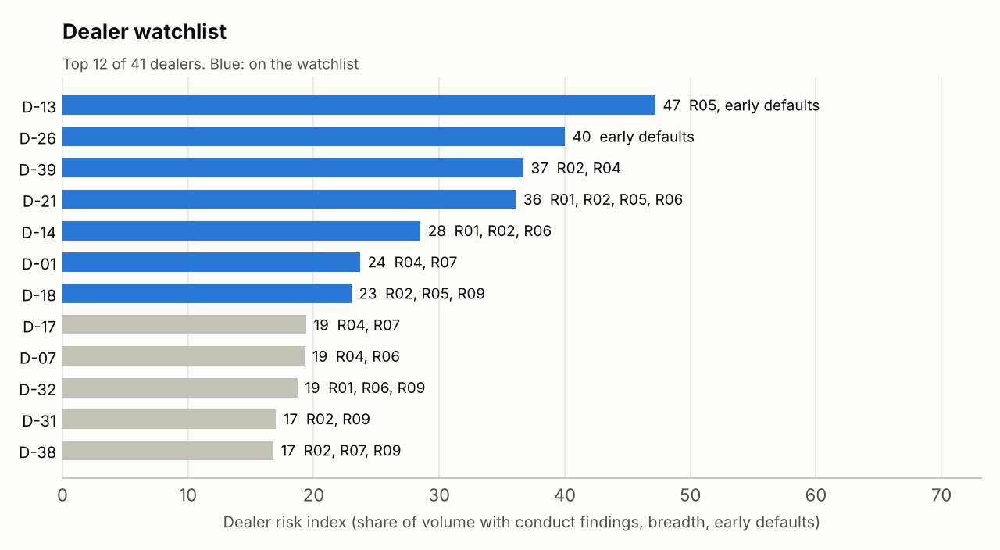

# Findings: fleet contract portfolio audit

*Simulated book as of 30 Jun 2026. All data invented.*  
*2,262 contracts in 710 deals, 41 dealers, 186 fleet customers, MXN 1,844.5M originated Jul 2023 to Mar 2026, MXN 1,236.0M still open.*

## Headline

- **199 contracts need review** (13 high, 186 medium), carrying **MXN 132.3M** of financing (7.2% of originations).
- **7 dealers on the watchlist**, 2 of them for early defaults that are too frequent to be chance.
- **3 customers were funded past their exposure limit**; MXN 1.9M of manufacturer subvention sits on contracts with program problems and may be clawed back.
- A further **73 contracts sit in the review queue**: weak signals (slow splits that are often genuine repeat orders) and the statistical layer's most unusual 1%.
- Data-quality gate: all 13 checks passed.

## By rule

| Rule | Finding | Owner | Contracts (medium or high) | Financed |
|---|---|---|---:|---:|
| R12 | Deal above approver authority | Internal control | 56 | MXN 30.6M |
| R04 | Split deal under authority | Dealer conduct | 42 | MXN 20.0M |
| R01 | Markup over cap | Dealer conduct | 15 | MXN 12.5M |
| R06 | Advance over policy | Dealer conduct | 13 | MXN 11.7M |
| R03 | Payment does not reconcile | Internal control | 12 | MXN 10.2M |
| R08 | Tier better than score | Internal control | 12 | MXN 8.9M |
| R09 | Backdated contract | Dealer conduct | 11 | MXN 8.7M |
| R02 | Residual above table | Dealer conduct | 12 | MXN 8.3M |
| R07 | Incentive outside program | Dealer conduct | 10 | MXN 7.6M |
| R10 | Customer over exposure limit | Internal control | 7 | MXN 6.0M |
| R05 | VIN financed twice | Dealer conduct | 6 | MXN 5.3M |
| R13 | Near-duplicate VIN | Dealer conduct | 3 | MXN 2.4M |

## Strongest example of each finding

| Rule | Contract | Dealer | Score | Evidence |
|---|---|---|---:|---|
| R12 | FC-01704 | D-16 | 30 | DL-00541 total 3,714,000 signed by AP-03 (L1, authority 2,500,000) |
| R04 | FC-02127 | D-07 | 30 | 2 near-limit deals (DL-00665, DL-00666) total 4,573,200 vs top authority 2,500,000 |
| R01 | FC-01571 | D-09 | 35 | markup 400 bps vs cap 200 bps |
| R06 | FC-00813 | D-07 | 50 | LTV 133% (cap 115%), add-ons 17%, price 105% of MSRP |
| R03 | FC-00731 | D-24 | 35 | booked 19759.04 vs recomputed 22632.47 |
| R08 | FC-01182 | D-11 | 35 | score 709 earns tier B, booked tier A, override none, approver L1 |
| R09 | FC-01668 | D-18 | 40 | entered 34 days after contract date; PRG-05 closed 2025-07-27 |
| R02 | FC-00571 | D-24 | 25 | residual 42.0% vs table 38.0% |
| R07 | FC-01526 | D-28 | 25 | PRG-04 (2025-02-11 to 2025-06-09) on EVN-C1 (not eligible) dated 2025-05-09, term 48 |
| R10 | FC-01238 | D-35 | 30 | C-0091 exposure 5,385,202 vs limit 4,100,000 on 2025-01-28 |
| R05 | FC-01159 | D-13 | 40 | VIN 9XF61MEBEWJG4EFMH already on FC-00928 (funded 2024-08-11, ACTIVE) |
| R13 | FC-01034 | D-22 | 35 | VIN 9XF5DYKYWL5HRWNM4 differs by one character from 9XF5DYKYWL5HRVNM4 on FC-00800 (PKP-H1 2024) |

## Dealer watchlist

| Dealer | Risk index | Conduct findings | Early defaults |
|---|---:|---|---|
| D-13 Flotillas Encino | 47 | 1 contract (R05) | 13/58 (flagged) |
| D-26 Camiones Laguna Seca | 40 | 0 contracts (none) | 17/68 (flagged) |
| D-39 Distribuidora Automotriz Cumbres | 37 | 19 contracts (R02, R04) | 0/46 |
| D-21 Motores Encino | 36 | 13 contracts (R01, R02, R05, R06) | 0/69 |
| D-14 Distribuidora Automotriz Puerta Norte | 28 | 10 contracts (R01, R02, R06) | 1/75 |
| D-01 Motores Arcos | 24 | 7 contracts (R04, R07) | 0/32 |
| D-18 Flotillas Paso Ancho | 23 | 4 contracts (R02, R05, R09) | 0/47 |

## What I would do on Monday

1. Put the watchlist dealers on enhanced funding review and pull deal jackets for their 54 flagged contracts, starting with VIN duplicates and split deals.
2. Re-price or recover: markup and residual breaches get dealer chargebacks; program misuse and backdating get reported to the manufacturer before the subvention claim is paid.
3. Fix the controls that let it through: AP-05 (45 findings), AP-03 (34 findings), AP-06 (18 findings) need a second signature, and limit checks must run at funding, not at approval.

Full queue: `findings.csv`. Dealer and approver detail: `dealer_scorecard.csv`, `approver_scorecard.csv`. Detection quality on 20 books: `evaluation.md`.
